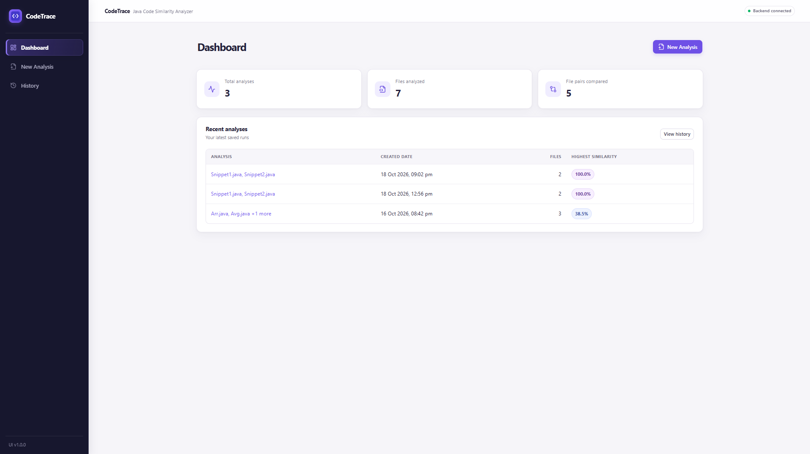
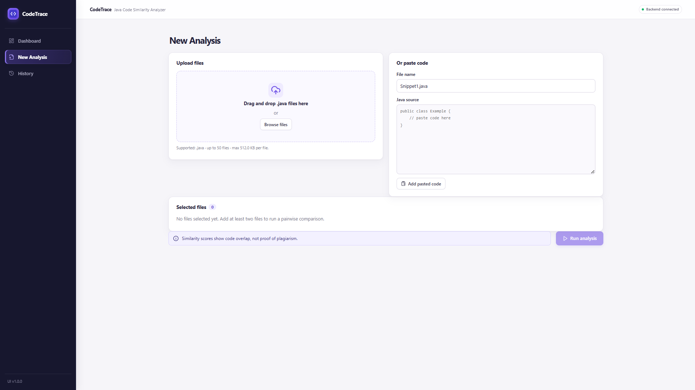
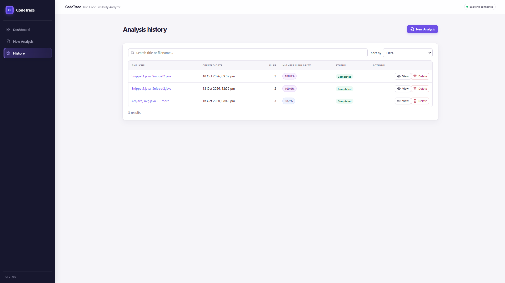

# CodeTrace — Java Code Similarity Analyzer

CodeTrace is a web-based application that compares Java source files to identify potentially similar code. It calculates similarity scores, highlights matching code patterns, and stores analysis results for future review.

The project combines Java, Spring Boot, React, PostgreSQL, and code similarity algorithms in a full-stack application.

> **Disclaimer:** Similarity scores indicate code overlap and do not, by themselves, prove plagiarism.

## Table of Contents

1. [Project Overview](#1-project-overview)
2. [Features](#2-features)
3. [Screenshots](#3-screenshots)
4. [Tech Stack](#4-tech-stack)
5. [Project Structure](#5-project-structure)
6. [Prerequisites](#6-prerequisites)
7. [Setup and Run](#7-setup-and-run)
8. [How It Works](#8-how-it-works)
9. [API Endpoints](#9-api-endpoints)
10. [Testing and Limitations](#10-testing-and-limitations)
11. [Author](#11-author)

## 1. Project Overview

CodeTrace helps users compare multiple Java programs without manually examining every source file. It analyzes code using token-based similarity techniques and presents comparison results through a web interface.

Users can review similarity scores, inspect matching code regions, revisit previous analyses, and export results in CSV or JSON format.

## 2. Features

- **Java source comparison:** Upload multiple Java files for analysis.
- **Similarity scoring:** Calculate and rank similarity between file pairs.
- **Matching regions:** Inspect code sections identified as similar.
- **Identifier normalization:** Reduce the effect of identifier-name differences during comparison.
- **Analysis history:** View previously saved analyses.
- **Interactive dashboard:** Access analysis information through a web interface.
- **CSV and JSON export:** Export analysis results for further review.
- **REST API:** Access backend functionality through HTTP endpoints.

## 3. Screenshots

### Dashboard



### New Analysis



### Analysis History



## 4. Tech Stack

| Technology | Purpose |
|---|---|
| Java 21 | Backend programming |
| Spring Boot | REST API and backend services |
| Maven | Dependency management and builds |
| React | User interface |
| Vite | Frontend development and build tool |
| PostgreSQL | Database |
| Flyway | Database migrations |
| JUnit and Mockito | Backend testing |
| Vitest and Testing Library | Frontend testing |
| Postman | API testing |

## 5. Project Structure

```text
CodeTrace/
├── backend/                 # Spring Boot backend
├── frontend/                # React and Vite frontend
├── sample-data/             # Sample Java files
├── docs/
├── .vscode/                 # VS Code configuration
├── .env.example             # Example environment settings
├── docker-compose.yml       # Docker configuration
└── README.md                # Project documentation
```

## 6. Prerequisites

Install the following software:

- JDK 21
- Apache Maven
- Node.js and npm
- PostgreSQL
- Visual Studio Code (recommended)
- Docker (optional, if using the Docker configuration)

Verify your installations:

```bash
java -version
mvn -version
node -v
npm -v
psql --version
```

## 7. Setup and Run

### Step 1: Configure the database

Start PostgreSQL and create a database and user if they do not already exist.

```sql
CREATE USER codetrace WITH PASSWORD 'choose-a-password';
CREATE DATABASE codetrace OWNER codetrace;
```

Configure the backend database URL, username, and password using the project's configuration or environment variables.

Example database URL:

```text
jdbc:postgresql://localhost:5432/codetrace
```

Use your own password and never commit database credentials to GitHub.

### Step 2: Start the backend

Open a terminal in the project root:

```bash
cd backend
mvn spring-boot:run
```

The backend uses port `8080` by default, unless configured otherwise.

Check the health endpoint:

`http://localhost:8080/api/health`

### Step 3: Start the frontend

Open a second terminal in the project root:

```bash
cd frontend
npm install
npm run dev
```

Open the local URL printed by Vite. The default is:

`http://localhost:5173`

If you use a different backend URL or port, update the frontend API configuration.

### Step 4: Run an analysis

1. Open CodeTrace in your browser.
2. Navigate to **New Analysis**.
3. Upload two or more supported `.java` files.
4. Run the comparison.
5. Review similarity scores and matching regions.
6. Visit **History** to access saved analyses.
7. Export results as CSV or JSON when needed.

## 8. How It Works

CodeTrace processes source files through the following stages:

1. **File validation:** Checks uploaded files before analysis.
2. **Tokenization:** Converts source code into tokens for comparison.
3. **Normalization:** Normalizes identifiers according to the selected settings.
4. **Jaccard similarity:** Compares token shingles to measure overlap between files.
5. **Winnowing:** Uses selected fingerprints from token hashes to help identify matching code sequences.
6. **Storage:** Saves analysis results in PostgreSQL.
7. **Presentation:** Displays scores, comparisons, and matching regions in the frontend.

### Algorithms

**Jaccard similarity**

Measures the overlap between two sets of token shingles.

\[
J(A,B)=\frac{|A\cap B|}{|A\cup B|}
\]

A higher score indicates greater overlap between the compared sets.

**Winnowing**

Selects fingerprints from token-hash sequences to help detect matching sections of code efficiently.

These algorithms support code comparison, but they do not fully understand program semantics or determine the author's intent.

## 9. API Endpoints

The following table lists the project's main API endpoints.

| Method | Endpoint | Purpose |
|---|---|---|
| GET | `/api/health` | Check backend health |
| GET | `/api/config` | Retrieve application configuration |
| POST | `/api/analyses` | Submit a new analysis |
| GET | `/api/analyses` | Retrieve analysis history |
| GET | `/api/analyses/{id}` | Retrieve an analysis |
| GET | `/api/analyses/{id}/comparisons/{comparisonId}` | Retrieve comparison details |
| DELETE | `/api/analyses/{id}` | Delete an analysis |
| GET | `/api/analyses/{id}/export?format=csv` | Export analysis as CSV |
| GET | `/api/analyses/{id}/export?format=json` | Export analysis as JSON |
| GET | `/api/dashboard` | Retrieve dashboard data |

For request bodies, parameters, and response examples, refer to the backend implementation or the Postman collection included in the project, if available.

## 10. Testing and Limitations

### Backend tests

Run these commands from the project root:

```bash
cd backend
mvn test
mvn verify
```

### Frontend tests

Run these commands from the project root:

```bash
cd frontend
npm test
npm run build
```

Tests that depend on PostgreSQL, Docker, or other external services may require those services to be available.

### Limitations

- The analyzer is designed for Java source files.
- Similarity scores do not independently prove plagiarism.
- Common boilerplate and standard algorithms may produce similar results.
- Major structural changes can reduce detected similarity.
- Identifier normalization does not provide complete semantic understanding.
- Large batches may take longer to process.
- Authentication and authorization should be considered before exposing the application to untrusted users or public networks.

## 11. Author

**Supritha Gunaga**

- **GitHub:** [suprithagunaga](https://github.com/suprithagunaga)
- **LinkedIn:** [Supritha Gunaga](https://linkedin.com/in/supritha-gunaga-b148bb3b0)

---

*CodeTrace — A full-stack Java project demonstrating REST API development, database integration, code similarity algorithms, and frontend development.*